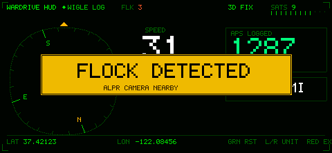

# Wardrive HUD

A framebuffer **wardriving heads-up display** for the Pager — and, at the same
time, a **Flock Safety ALPR hunter**. The ultimate take-it-on-the-road HUD: an
aviation-style display with a rotating **compass rose** + heading, a big **speed**
readout, live **GPS fix / satellite** status, a running count of **access points
logged** (total + new this trip), **trip distance**, and **lat/lon** — while it
passively watches for Flock cameras and **flashes a warning + plays an alert tone**
the moment one is near.

It drives the Pager's **built-in WiGLE logger** (stock recon / `pineapd`) for the
actual Wi-Fi capture, so there's **no radio conflict** and the log is written in
the stock, upload-ready format. The HUD is the display layer on top, and the Flock
hunter listens passively on the same radios.

- **Author:** Jenx
- **Category:** reconnaissance

## Controls
- **Left / Right** — cycle speed units (MPH / KMH / KN); distance follows (mi/km)
- **Green (A)** — reset the **trip meters** (zeroes "new this trip" APs + trip
  distance only; the session total and the WiGLE log keep going)
- **Red (B)** — exit (stops the WiGLE log, writes the Flock map, prints a summary)
- **Power** — display sleep (press again / any button to wake); the HUD keeps running

## Two jobs at once

**1. WiGLE wardriving (stock).** On launch the payload runs **`WIGLE_START`**, so
`pineapd` does the Wi-Fi scanning and writes GPS-stamped rows to a stock
**WigleWifi-1.6 CSV** in `/root/loot/wigle/` (upload-ready). The HUD's **APS
LOGGED** counter is the row count of that CSV. On exit it runs **`WIGLE_STOP`**.
To upload: **`WIGLE_LOGIN`** once, then **`WIGLE_UPLOAD /root/loot/wigle/<file>.csv`**.

**2. Flock hunting (passive).** At the same time it listens for **Flock Safety**
ALPR cameras and their accessories — their Wi-Fi SSIDs/OUIs and BLE signatures
(from [flock-you](https://github.com/colonelpanichacks/flock-you), MIT) — on
`pineapd`'s monitor interface(s) and BLE (`blue5`). Every hit is GPS-tagged and
written to its **own** session under `/root/loot/wardrive_hud_flock/<timestamp>/`:
a `wigle.csv`, a `hits.csv`, and a `flock.kml` map (built on exit). Listen-only.

When a high-confidence Flock device is detected the HUD **flashes a yellow
`FLOCK DETECTED` banner** and plays a short **alert tone** (`RINGTONE`, an homage
to the Metal Gear Solid alert — not the original sound). A persistent **`FLK n`**
tally in the top bar counts hits for the trip.

## Firmware
Works on **fw 2.0** and **1.1.x**. The important 2.0 change: **gpsd is off** on
2.0, so the HUD reads GPS from **`pineapd`'s GPS API** (`/api/pineap/gps/get`);
on 1.1.x it falls back to **gpsd** (`gpspipe`). Because that API reports no
heading, **course is derived from successive positions** (so the compass needs
you to be moving). BLE uses **`blue5`** on 2.0, BlueZ on 1.1.x.

## Requirements
A **USB GPS**. On 1.1.x the payload auto-installs gpsd if missing (needs internet
once). WiGLE/Flock rows get a position only once there's a fix (mode ≥ 2D) —
standard for wardriving; Flock hits with no fix are still logged (without a
position, so they're not placed on the map).

## How it works
One GPS reader feeds both the HUD (`/tmp/wd_gps`) and the Flock logger
(`/tmp/wd_fix`): it polls the pineapd API (or gpsd), parses position/speed/sats,
and derives heading + trip distance (equirectangular, glitch-filtered). A
**composer** merges the GPS state, the stock WiGLE row count, and the Flock state
into one `/tmp/wardrive.dat` that the native binary renders at ~10 fps. Flock
matchers (`tcpdump` + `blue5ctl` → awk) log hits and raise the on-screen alert.

The binary is freestanding, integer-only (the MT7628 has no FPU), drawn upright
480×222 and rotated into the 222×480 framebuffer, using the official
`UI_TAKEOVER` / `UI_RELEASE` handoff.

### Speed units note
The pineapd GPS API reports speed in **m/s** (as gpsd does); the HUD converts to
MPH/KMH/KN. If your unit ever looks off by a constant factor, that's the field to
check.

> Verified on-device (fw 2.0): the HUD renders, `WIGLE_START` logs, the GPS-API
> reader runs, and a simulated Flock hit raises the `FLOCK DETECTED` banner, bumps
> `FLK`, fires the tone, and writes the separate Flock loot. The full HUD layout
> was also checked via the host preview (`-DHOST_PREVIEW`). A live GPS fix
> (outdoors) is needed for non-zero position/speed; a real Flock camera for a
> live detection.

## Credits
Flock signatures from **flock-you** by colonelpanichacks (MIT). This payload is
listen-only and logs to WiGLE/KML; it does not transmit.
